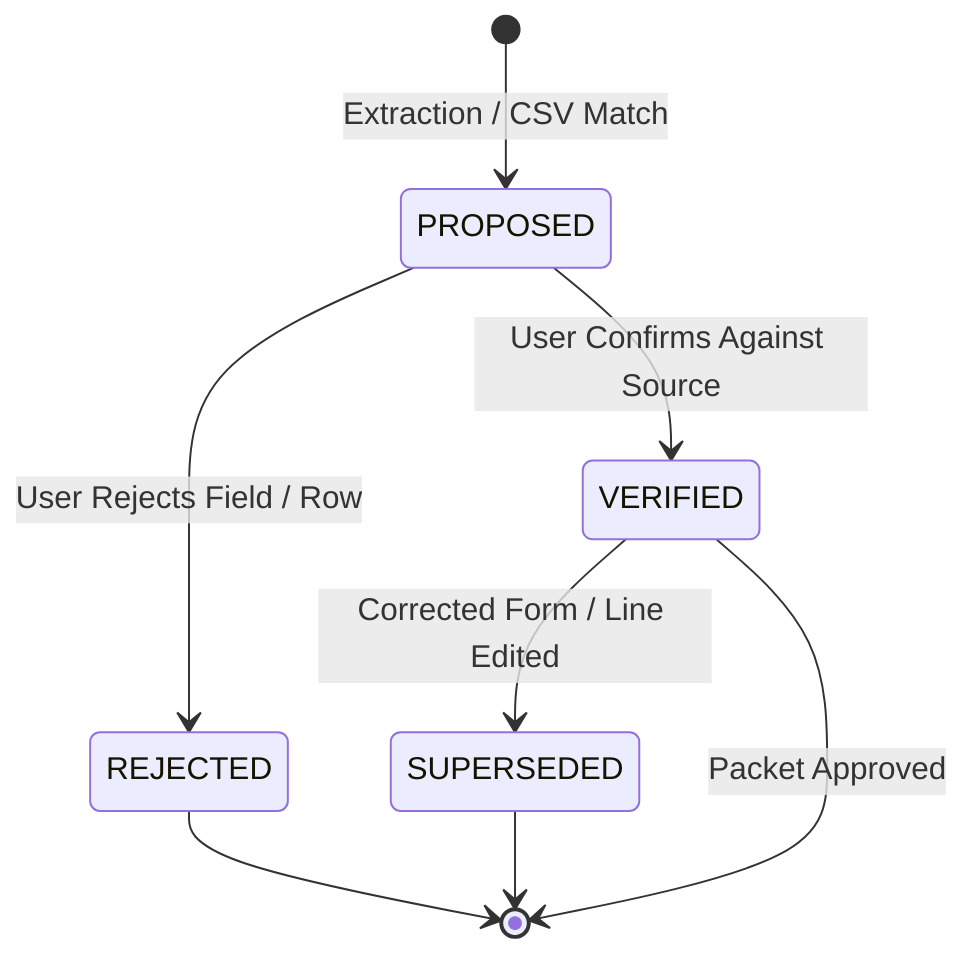

# Tax Workspace Contracts & Data Model Specification

Authoritative contract specification for the 2025 Federal & California TaxAct review
system. Defines data transfer objects (DTOs), field formats, state machines,
numeric policies, and service interfaces for Local Ledger tax preparation tasks.

---

## 1. Scope & System Boundaries

### 1.1 Confirmed Scope
- **Tax Year:** Calendar year 2025.
- **Jurisdictions:**
  - **Federal:** Internal Revenue Service (IRS Form 1040, Schedules B, D, E, Form 8949).
  - **California:** Franchise Tax Board (FTB Form 540, Schedule CA 540, Form 3801, FTB 3885A).
- **Domain Focus:**
  1. **Investments:** Consolidated brokerage 1099s (1099-INT, 1099-DIV, 1099-B). Reconcile
     proceeds, cost basis, covered/noncovered status, wash-sale adjustments, and capital gain distributions.
  2. **Rental Income:** Residential rental properties (Schedule E). Reconcile rental receipts,
     operating expenses, mortgage interest (Form 1098), escrow taxes, asset depreciation schedules,
     and repairs vs. capital improvements.
  3. **California Differences:** Track federal vs. California differences for depreciation, Section 179,
     passive activity losses, and prior-year capital loss carryovers.
  4. **TaxAct Cross-Check:** Map verified source working papers directly to TaxAct input fields,
     surface discrepancies, explain rationale with official citations, and export verified evidence packets.

### 1.2 Explicit Non-Goals / Boundaries
- **No Tax Calculation Engine:** Local Ledger does not compute final tax liability or refund.
  TaxAct remains the tax calculation engine.
- **No Electronic Filing:** No MeF (Modernized e-File) XML transmission or IRS/FTB submission.
- **No Direct TaxAct Automation:** No web-scraping or browser automation into TaxAct.
- **No Cloud Egress of Tax Records:** Raw tax forms and documents never enter cloud prompts
  or external APIs. All model assistance is strictly local-only.

---

## 2. Representation & Conversion Policies

### 2.1 Numeric Precision Policy
- **Currency Amounts:** Stored strictly as **integer cents** (`amount_cents: int`).
  - Example: `$1,250.75` -> `125075`.
  - Floating-point `float` types are strictly prohibited for financial balances and totals.
- **Share / Unit Quantities:** Fractional shares (common in dividend reinvestment) are stored
  as fixed-precision decimal strings with up to 6 decimal places (`quantity: str`), e.g., `"142.857143"`.
- **Ownership / Allocation Percentages:** Stored in integer basis points (`basis_points: int`,
  where `10000 = 100.00%`, `5000 = 50.00%`).
- **Verbatim Text Preservation:** Every parsed or user-entered numeric value preserves the original
  raw string representation (`raw_text: str`) for auditing against source documents.

### 2.2 Date Formatting
- All dates follow ISO-8601 extended format: `YYYY-MM-DD`.
- When acquisition dates are various/inherent (e.g. Form 8949 Box 1b "VARIOUS"), `date_acquired`
  is `None` with `date_acquired_special="VARIOUS"`.

### 2.3 Tax Treatment vs. Budget Category Policy
- **Strict Separation:** A budget category in Local Ledger (e.g. "Housing" or "Contractor") is
  **never** synonymous with a tax classification or tax deductibility.
- Tax treatment decisions require explicit assignment to a tax form line and must cite applicable
  tax authority (IRS Publication, IRC Section, or FTB Schedule).

---

## 3. Data Transfer Objects (DTOs)

The following Python dataclasses define the shared contract across tax modules.

```python
from __future__ import annotations

from dataclasses import dataclass, field
from datetime import datetime
from enum import StrEnum
from typing import Any


class DocumentType(StrEnum):
    FORM_1099_CONSOLIDATED = "1099_CONSOLIDATED"
    FORM_1099_B = "1099_B"
    FORM_1099_DIV = "1099_DIV"
    FORM_1099_INT = "1099_INT"
    FORM_1098_MORTGAGE = "1098_MORTGAGE"
    RENTAL_ANNUAL_STATEMENT = "RENTAL_ANNUAL_STATEMENT"
    PROPERTY_TAX_BILL = "PROPERTY_TAX_BILL"
    PRIOR_YEAR_RETURN_FED = "PRIOR_YEAR_RETURN_FED"
    PRIOR_YEAR_RETURN_CA = "PRIOR_YEAR_RETURN_CA"
    CLOSING_STATEMENT_HUD1 = "CLOSING_STATEMENT_HUD1"
    OTHER_EVIDENCE = "OTHER_EVIDENCE"


class EvidenceStatus(StrEnum):
    PROPOSED = "PROPOSED"      # Proposed by OCR / local model extraction
    VERIFIED = "VERIFIED"      # Explicitly confirmed by human reviewer
    REJECTED = "REJECTED"      # Rejected by human reviewer (will not enter totals)
    SUPERSEDED = "SUPERSEDED"  # Replaced by a corrected document or re-verified field


class ReconciliationStatus(StrEnum):
    MATCHED = "MATCHED"          # Source working paper matches TaxAct figure exactly
    DISCREPANCY = "DISCREPANCY"  # Verified delta between source and TaxAct input
    UNRESOLVED = "UNRESOLVED"    # Pending missing document or review question


class HoldingTerm(StrEnum):
    SHORT_TERM = "SHORT_TERM"
    LONG_TERM = "LONG_TERM"


class Jurisdiction(StrEnum):
    FEDERAL = "US-FED"
    CALIFORNIA = "US-CA"


@dataclass(frozen=True)
class SourceLocator:
    """Precise location of an evidence item within a source document."""
    document_id: str
    page_number: int  # 1-based page index
    box_or_line: str  # e.g., "Box 1a", "Line 3", "Column e"
    snippet_text: str  # verbatim text extracted from the document
    bounding_box: tuple[float, float, float, float] | None = None  # (x0, y0, x1, y1) normalized 0..1


@dataclass(frozen=True)
class TaxDocumentDTO:
    """Immutable record of an ingested tax document."""
    id: str
    workspace_id: str
    file_name: str
    sha256_hash: str
    doc_type: DocumentType
    page_count: int
    is_corrected: bool = False
    supersedes_doc_id: str | None = None
    storage_path: str = ""  # Private path outside repository
    ingested_at: datetime = field(default_factory=datetime.utcnow)


@dataclass(frozen=True)
class ExtractedFieldDTO:
    """Individual field proposed or verified from a document."""
    id: str
    document_id: str
    locator: SourceLocator
    field_name: str  # e.g. "1099_DIV.box1a_ordinary_dividends"
    raw_text: str
    amount_cents: int
    status: EvidenceStatus
    model_provenance: dict[str, Any] | None = None  # profile, model, prompt_version, latency_ms
    verified_by: str | None = None
    verified_at: datetime | None = None
    notes: str | None = None


@dataclass(frozen=True)
class InvestmentSaleRecordDTO:
    """Individual stock/security disposition for Form 8949 / Schedule D audit."""
    id: str
    workspace_id: str
    source_document_id: str
    security_description: str
    cusip_or_ticker: str | None
    date_acquired: str | None  # YYYY-MM-DD or None if VARIOUS
    date_sold: str             # YYYY-MM-DD
    proceeds_cents: int
    cost_basis_cents: int
    gain_loss_cents: int
    term: HoldingTerm
    basis_reported_to_irs: bool
    wash_sale_disallowed_cents: int = 0
    fed_ca_difference_cents: int = 0
    status: EvidenceStatus = EvidenceStatus.PROPOSED
    locator: SourceLocator | None = None


@dataclass(frozen=True)
class TaxPropertyDTO:
    """Rental real estate property record for Schedule E audit."""
    id: str
    workspace_id: str
    street_address: str
    city: str
    state: str
    zip_code: str
    property_type: str  # e.g., "Single Family", "Condo"
    ownership_basis_points: int = 10000  # 10000 = 100%
    days_rented: int = 365
    days_personal_use: int = 0
    date_placed_in_service: str = ""  # YYYY-MM-DD


@dataclass(frozen=True)
class RentalExpenseRecordDTO:
    """Rental operating expense line item linked to source evidence."""
    id: str
    workspace_id: str
    property_id: str
    category: str  # e.g., "repairs", "insurance", "mortgage_interest", "taxes", "management"
    amount_cents: int
    source_document_id: str | None = None
    source_transaction_id: int | None = None  # FK to local-ledger transaction.id if from bank CSV
    locator: SourceLocator | None = None
    treatment_authority: str = "IRC § 162 / IRS Pub 527"
    is_capital_improvement_suspect: bool = False
    status: EvidenceStatus = EvidenceStatus.PROPOSED


@dataclass(frozen=True)
class AssetDepreciationDTO:
    """Depreciable asset tracking for Schedule E / Form 4562 and FTB 3885A."""
    id: str
    property_id: str
    description: str
    date_placed_in_service: str  # YYYY-MM-DD
    cost_basis_cents: int
    land_value_cents: int
    depreciable_basis_cents: int
    recovery_years: float  # e.g. 27.5
    prior_depreciation_fed_cents: int
    prior_depreciation_ca_cents: int
    current_depreciation_fed_cents: int
    current_depreciation_ca_cents: int
    state_difference_reason: str = "MACRS vs CA Modified S/L"


@dataclass(frozen=True)
class JurisdictionCarryoverDTO:
    """Tracks federal vs. California prior-year carryovers."""
    id: str
    workspace_id: str
    jurisdiction: Jurisdiction
    category: str  # e.g., "CAPITAL_LOSS", "PASSIVE_ACTIVITY_LOSS"
    property_id: str | None = None
    prior_year_cents: int = 0
    utilized_current_year_cents: int = 0
    remaining_carryover_cents: int = 0
    prior_return_reference: str = ""  # Form and line on 2024 return


@dataclass(frozen=True)
class ReconciliationItemDTO:
    """Comparison item between source working papers and TaxAct inputs."""
    id: str
    workspace_id: str
    tax_section: str  # e.g., "Federal > Investment Income > 1099-DIV"
    field_key: str    # e.g., "total_ordinary_dividends"
    source_working_paper_cents: int
    taxact_entered_cents: int
    delta_cents: int
    status: ReconciliationStatus
    explanation: str
    authority_citation: str
    supporting_document_ids: list[str] = field(default_factory=list)


@dataclass(frozen=True)
class EvidencePacketManifestDTO:
    """Immutable manifest accompanying an export packet."""
    workspace_id: str
    tax_year: int
    generated_at: datetime
    content_hash: str
    is_draft: bool
    reconciliation_items: list[ReconciliationItemDTO]
    open_questions: list[str]
    document_hashes: dict[str, str]  # doc_id -> sha256
```

---

## 4. State Machines & Transitions



### 4.1 Transition Invariant Rules
1. **No Unverified Data in Approved Totals:** Only items with `EvidenceStatus.VERIFIED` may contribute
   to `source_working_paper_cents` in final reconciliation. `PROPOSED`, `REJECTED`, or `SUPERSEDED`
   items are excluded from approved totals.
2. **Supersession Invalidation:** When a corrected document is uploaded (e.g. `1099-B (Corrected)`):
   - All fields extracted from the previous version transition to `SUPERSEDED`.
   - Any previously generated `ReconciliationItemDTO` referencing superseded fields is flagged `DISCREPANCY`
     or `UNRESOLVED` until re-verified.
3. **Ledger Edit Invalidation:** If a committed transaction linked via `source_transaction_id` is edited or deleted
   in Local Ledger, all affected `RentalExpenseRecordDTO` records are reset to `PROPOSED` for review.

---

## 5. Shared Service Protocols

These contracts establish the APIs that TAX-04 (Persistence), TAX-05 (Intake UI),
TAX-06 (Reconciliation), and TAX-08 (Packet Export) will implement and consume:

```python
from typing import Protocol


class TaxWorkspaceService(Protocol):
    def get_or_create_workspace(self, tax_year: int, jurisdiction: str) -> str:
        """Return workspace ID for the given tax year and primary jurisdiction."""
        ...

    def list_documents(self, workspace_id: str) -> list[TaxDocumentDTO]:
        """List all documents registered in the workspace."""
        ...

    def register_document(
        self,
        workspace_id: str,
        file_name: str,
        content_sha256: str,
        doc_type: DocumentType,
        page_count: int,
        storage_path: str,
        is_corrected: bool = False,
        supersedes_doc_id: str | None = None,
    ) -> TaxDocumentDTO:
        """Register an immutable document original in private storage."""
        ...


class TaxReconciliationService(Protocol):
    def compute_investment_totals(self, workspace_id: str) -> dict[str, int]:
        """Compute verified annual dividend, interest, and capital gain totals."""
        ...

    def compute_rental_totals(self, workspace_id: str, property_id: str) -> dict[str, int]:
        """Compute verified gross rents, categorized expenses, and net rental flow."""
        ...

    def compare_taxact_input(
        self,
        workspace_id: str,
        tax_section: str,
        field_key: str,
        taxact_entered_cents: int,
    ) -> ReconciliationItemDTO:
        """Compare user-entered TaxAct amount against reviewed working paper total."""
        ...
```

---

## 6. Synthetic Fixture Specifications

To guarantee reproducible qualification without exposing private tax returns, synthetic
fixtures are standardized in `docs/tax-filing/fixtures/`:

1. **`brokerage-1099-consolidated.json`**:
   - Includes 1099-INT ($1,425.50), 1099-DIV ($3,850.00 ordinary, $2,900.00 qualified).
   - Form 8949 stock sales: Covered short-term gains, covered long-term gains, one wash sale
     disallowance ($320.00), and one noncovered lot with missing basis requiring manual basis entry.
2. **`rental-statement-property-a.json`**:
   - Single-family rental in California (100% rental use).
   - Gross rents: $36,000.00.
   - Operating expenses: Insurance ($1,850.00), Management ($2,880.00), Repairs ($1,420.00).
   - Form 1098: Mortgage interest ($12,450.00) vs. principal ($8,200.00 excluded from expenses).
   - Property tax bill: County property taxes ($5,600.00).
3. **`california-carryovers.json`**:
   - Federal capital loss carryover: $3,000.00 limit with $4,500.00 remaining carryover.
   - California vs. Federal depreciation delta on Property A ($420.00 due to bonus depreciation difference).
