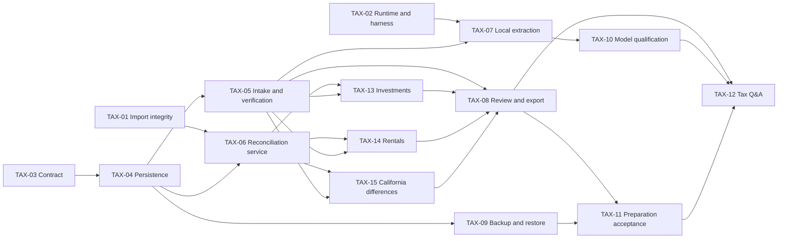

# Tax preparation implementation backlog

Created September 28, 2026 from the [readiness assessment](readiness-2026-09-28.md).
These are repository-local work items; no external issues have been created.
All are open. Confirmed scope: 2025 federal/California investment and rental
income; audit and explain TaxAct inputs, with no tax-engine or filing rebuild. Dependencies mean merged prerequisites, not merely started work.
Sizes are relative: S = narrow change, M = several related components,
L = cross-component feature. They are not elapsed-time commitments.

## Queue and dependencies

| ID | Task | Priority | Size | Status | Prerequisites |
| --- | --- | --- | --- | --- | --- |
| TAX-01 | Repair import integrity and review | P0 | L | **COMPLETE** (agent A) | None |
| TAX-02 | Make local runtime and evaluation harness reproducible | P0 | M | **COMPLETED** (agent B) | None |
| TAX-03 | Define tax workspace contract and supported scope | P0 | S | **COMPLETED** (agent B) | None |
| TAX-04 | Persist tax workspace and evidence lifecycle | P0 | L | **HARDENED** (agent B, then review fixes) | TAX-03 |
| TAX-05 | Build document intake and manual verification UI | P1 | L | Not started | TAX-04 |
| TAX-06 | Build annual reconciliation and tax classification service | P1 | L | **COMPLETE** (2026-09-29) | TAX-01, TAX-04 |
| TAX-07 | Add local extraction proposals with citations | P1 | L | Not started | TAX-02, TAX-05 |
| TAX-08 | Build TaxAct input comparison and evidence packet | P1 | L | Not started | TAX-05, TAX-06, TAX-13, TAX-14, TAX-15 |
| TAX-09 | Add tax workspace backup and restore | P1 | M | **COMPLETED** (agent D, 2026-09-29) | TAX-04 |
| TAX-10 | Qualify local models on synthetic tax documents | P1 | M | Not started | TAX-07 |
| TAX-11 | Validate complete preparation journeys and document handoff | P1 | M | Not started | TAX-08, TAX-09 |
| TAX-12 | Add evidence-grounded local tax Q&A | P2 | M | Not started | TAX-08, TAX-10, TAX-11 |
| TAX-13 | Audit investment statements and TaxAct figures | P1 | M | Not started | TAX-05, TAX-06 |
| TAX-14 | Audit rental working papers and TaxAct figures | P1 | M | Not started | TAX-05, TAX-06 |
| TAX-15 | Track federal/California differences and prior-year carryovers | P1 | M | Not started | TAX-05, TAX-06 |

Manual preparation milestone: TAX-01 through TAX-06, TAX-08, TAX-09, TAX-11 and TAX-13 through TAX-15.
Local-assisted preparation milestone: manual milestone plus TAX-07 and TAX-10.
TAX-12 is optional. Tax calculation engines and electronic filing are deferred.

## TAX-01 — Repair import integrity and review

**Owner scope:** `ingest/`, `ledger/dedup.py`, `llm/paste_parse.py`, import page,
staging review UI and corresponding tests. Any import-related model/migration
changes are owned here and coordinated with TAX-04.

Preserve payees, approved categories and source batch/row provenance. Route
accepted paste proposals through the same staging/commit service. Persist the
staged-row-to-transaction result and enforce commit idempotency in the service
and database where appropriate. Recheck conflicts at commit, cover duplicates
within a batch and across concurrent batches, and resolve payees by their FK.
Define NEW-row confirmation, require explicit acceptance of FUZZY rows, and
never commit REJECTED rows. Scope UI commits to the intended batch/account.

**Acceptance:** regression tests cover repeated clicks, repeated stage IDs,
same-batch duplicates, reimports with and without external IDs, concurrent
commits, rejected/pending fuzzy rows, payee/category retention and rollback of
both transaction and audit changes. A UI journey actually reviews and commits
the intended subset. Legitimate equal-valued purchases are not silently lost.

**Status: complete (agent A, 2026-09-28).** Implementation, tests, the commit
contract and the criterion-by-criterion test evidence are recorded in
[TAX-01 work log](tax-01-work-log.md). Unit suite at hand-off: 381 passed,
10 skipped. TAX-04 must rebase onto migration `e5f7a1c9d204` (staged-row
provenance columns plus the `transaction(account_id, imported_id)` unique
index). Import, dedup and the staged review UI are now stable enough for
TAX-06 to compute annual totals from.

## TAX-02 — Make local runtime and evaluation harness reproducible

**Owner scope:** local-server/provider configuration, settings UI, server unit
tests, existing integration spikes, README runtime instructions.

Make launcher location configurable or discoverable without relying on one
user's home directory. Inject filesystem/command checks in tests so fake
launchers do not require installed model scripts. Preserve server adoption,
single-flight startup and the current uncommitted runtime improvements.
Move integration evaluation to isolated databases/settings. Replace placeholder
scoring with explicit scored/unscored/failed/skipped results; never change user
provider preferences as a side effect of tests.

**Acceptance:** current seven failures resolved; missing executable, wrong
served model, delayed startup and retry behavior tested hermetically. Real
smoke command uses only synthetic input and records actual profile, model ID,
endpoint, timeout and latency. An unavailable model yields a deferred result,
not a pass. The default application DB/settings remain untouched. README
commands are checked against the selected installed runtime rather than
assuming its existing model names or RAM guidance are accurate.

**Status: completed (agent B, completed 2026-09-28).** All 7 startup failures
resolved hermetically; launcher discovery made configurable via `LOCAL_LEDGER_DS4_HOME` /
`DS4_HOME` and PATH discovery; integration test databases isolated; explicit rubric scoring
implemented; and synthetic smoke runner (`python -m local_ledger.llm.smoke`) added.
Full details in [TAX-02 work log](tax-02-work-log.md).

## TAX-03 — Define tax workspace contract and supported scope

**Owner scope:** new `docs/tax-filing/contracts.md` and synthetic fixture
specification; no application schema edits.

Document the confirmed 2025 federal/California TaxAct review workspace. Confirm
residency, property locations/ownership, investment types and TaxAct edition.
Prioritize consolidated brokerage 1099s (INT/DIV/B), rental statements and
expenses, prior returns and depreciation/carryover schedules. Explicitly scope
K-1s, digital assets, property sales and special situations if present. Include
property/asset IDs, investment sale records and separate federal/California
carryovers in the shared contract so later agents need no competing migrations. Define DTOs/service interfaces for workspace,
document version, source locator, field proposal, verification, classification,
reconciliation, question and packet manifest.

**Acceptance:** one documented contract defines cents/decimal conversion,
field types, IDs, year isolation, state transitions, corrections/supersession,
source hashes, model provenance and export versioning. Define which decisions
need applicable-year authority. Budget category is never synonymous with tax
treatment. No raw tax data enters existing cloud payloads. Unknown scope is
explicit; foundational APIs can be finalized before form-specific rules.

**Status: completed (agent B, completed 2026-09-28).** Data contracts, DTOs,
conversion policies, and service protocols defined in [contracts.md](contracts.md).
Validated synthetic fixtures for consolidated 1099s, rental statements, and California
carryovers created in `docs/tax-filing/fixtures/`. Zero schema edits introduced.
Full details in [TAX-03 work log](tax-03-work-log.md). TAX-04 persistence may now begin.

## TAX-04 — Persist tax workspace and evidence lifecycle

**Owner scope:** tax domain module, shared model registration, Alembic migration,
repository/service implementation and migration tests. Sole tax-schema owner.

Implement TAX-03, including manual field entry and verification events. Store
private documents outside the tracked source tree, retaining immutable originals
and corrected versions. Link each amount to document hash, page/form field or
transaction IDs. Track proposed, verified, rejected and superseded states,
reviewer/time, unresolved questions and stale downstream results after edits.

**Acceptance:** fresh/upgrade migrations preserve budgeting data; year isolation
and correction invalidation tested. Unverified/superseded values cannot enter
approved totals. Money conversion is exact and records the original text.
Private paths and raw values do not leak into ordinary error logs. Storage
location and retention behavior are documented.

**Status: implemented, then hardened (agent B, 2026-09-28; hardening after review).**
All 11 SQLModel domain models implemented in `src/local_ledger/tax/models.py` and registered
in `src/local_ledger/models.py`. Alembic migration
`f6a8b2c4d305_add_tax_workspace_and_evidence_tables.py` rebased cleanly on top of Agent A's
`e5f7a1c9d204`. Private document storage and PII/path masking in `src/local_ledger/tax/storage.py`.

A review on 2026-09-28 found four correctness gaps, all now fixed with regression
tests in `tests/unit/tax/test_tax_hardening.py`:

1. **Evidence could cross tax years.** A field in one workspace could reference
   another workspace's document and reach its verified totals, and a correction
   could rewrite that other workspace's field. Evidence now requires a document in
   the same workspace, a correction may only supersede within its own workspace,
   and no field can be proposed from an already-superseded document
   (`WorkspaceScopeError`).
2. **Superseded or rejected evidence could be reapproved**, putting a replaced
   amount back into an approved total. `PROPOSED` is now the only reviewable
   state on fields, rental expenses and investment sales
   (`InvalidStateTransitionError`); re-proposing is the way back.
3. **Real ledger deletion left tax comparisons marked matched.** The invalidation
   helper existed but no ledger mutation called it. `delete_transaction` now
   notifies the tax domain inside the same transaction via
   `ledger/invalidation.py`, so a deleted transaction and its stale marking land
   together.
4. **A non-draft packet could be created with open questions.** A final packet is
   refused while any question is open (`PacketReadinessError`); drafts stay
   available and labelled.

Two further defects found while fixing the above: a "correction" re-sending
identical bytes to the document it claimed to replace was silently dropped by the
duplicate-hash guard, and residency/filing status defaulted to unconfirmed values
(`FULL_YEAR` / `SINGLE`). Both now default to `UNKNOWN`. The enum change needs no
migration: the columns are Python-side defaults with no server default, so
existing rows keep whatever was actually recorded.

Unit suite at hand-off: **420 passed, 10 skipped**. Full detail in the
[TAX-04 work log](tax-04-work-log.md) and the hardening test module.

## TAX-05 — Build document intake and manual verification UI

**Owner scope:** `tax/intake.py`, document/field-review page, navigation wiring
and intake/UI tests; consume TAX-04 APIs without editing shared schema.

Support inventory, expected/missing documents, safe local file intake, source
preview, manual field entry and verification. Preserve page references when
extracting text from text PDFs. Detect scanned or unreadable documents and
provide manual entry; OCR is an explicitly scoped extension, not silent empty
success. Handle duplicate hashes, corrected documents, invalid/oversized files
and workspace mismatch. Select dependencies after checking current primary
documentation and licenses at implementation time.

**Acceptance:** synthetic text PDF and scanned PDF journeys retain originals;
duplicate upload does not create duplicate approved amounts; manual fields can
be verified against a visible source. Missing documents and unsupported types
remain visible. Parsing failures leave no half-registered approved records.

## TAX-06 — Build annual reconciliation and tax classification service

**Owner scope:** `tax/reconciliation.py`, `tax/classification.py` and service
tests; no shared schema or UI edits.

Compute explicit tax-year totals from verified source fields and classified
transactions, with traceable member IDs. Keep source-form totals separate from
bank-flow totals. Support transfer/refund exclusions, reviewed split allocations,
unresolved classifications and comparison deltas without double counting.
Record facts and applicable-year authority for reviewed treatment decisions;
form mapping is limited to the scope selected in TAX-03.

**Acceptance:** fixtures cover transfers, refunds, split allocations, year
boundaries, duplicate/corrected documents and unresolved items. Totals are exact,
reproducible and traceable. Unresolved values appear separately; a ledger edit
invalidates affected approvals/snapshots. No model is called for arithmetic.

**Status: complete (2026-09-29).** `tax/classification.py` holds the registered
treatment vocabulary plus the fact and authority behind each treatment;
`tax/reconciliation.py` holds exact, reproducible, traceable totals per basis
(source-form vs bank-flow) and persisted runs whose content hash covers the
totals *and their member ids*. 29 tests; unit suite 449 passed, 10 skipped.
Full detail, including one out-of-scope schema addition the coordinator may want
to revisit, in the [TAX-06 work log](tax-06-work-log.md).

## TAX-07 — Add local extraction proposals with citations

**Owner scope:** `tax/extraction.py`, tax-specific prompts/validators and tests;
coordinate the small intake-page action with TAX-05's owner.

Extract only supported field schemas through the local client. Preserve exact
source text and page/field references, model identifier and prompt version.
Handle chunk boundaries, repeated headers, corrected forms, malformed output,
timeouts and unsupported fields. Treat document text as untrusted data, with
no tool execution and no automatic verification. Use a dedicated local-only
transport path; no cloud fallback. Test redirects/proxy behavior as well as
configured host checks before claiming raw-document containment.

**Acceptance:** valid output creates proposals only; hallucinated/invalid source
locators are rejected or explicitly unresolved. Amounts/dates use strict
validation. Adversarial document instructions cannot change the workflow,
approve values or cause external calls. Model outages preserve manual work.

## TAX-08 — Build TaxAct input comparison and evidence packet

**Owner scope:** tax reconciliation page, `tax/export.py`, packet templates and
tests. Navigation edits coordinated with TAX-05; no intake page ownership.

Present annual totals, source comparisons, unresolved questions and TaxAct
entry checks. For each entry, show source → reviewed working-paper amount →
TaxAct section/field → user-entered amount → delta/status. Explain why a value
belongs there using verified 2025 authority and current documentation for the
user's TaxAct edition. When a screen is unverified, say so rather than inventing
a click path. Capture user-supplied TaxAct figures or supported exports locally;
no account automation is required. Export a versioned CSV/JSON manifest and readable packet containing
verified amounts, references, document status and discrepancies. Support draft
exports but label unresolved/unverified content explicitly. Approved exports
must identify the exact reviewed snapshot; changed evidence marks it stale.
Avoid embedding unnecessary identifiers or raw documents in the packet.

**Acceptance:** deterministic export reproduces reviewed totals and sources;
drafts cannot masquerade as approved packets. Deliberately incorrect TaxAct
entries, duplicate income, missing basis and missing rental support produce
focused discrepancies; resolved items retain their explanation and evidence. Formula-like text is safe in CSV
outputs. A reviewer can trace every approved amount to its evidence. No promise
of TaxAct import compatibility without validating the exact product/format.

## TAX-09 — Add tax workspace backup and restore

**Owner scope:** `tax/backup.py`, backup manifest, CLI or dedicated settings
section and backup tests. Shared settings UI changes serialized with TAX-02.

Take a consistent SQLite snapshot and include referenced originals, extracted
data and review history in a private destination. Document access permissions
and at-rest protection assumptions. Restore into a separate target first,
validate schema/version and hashes, and fail clearly on incomplete backups.

**Acceptance:** a restored synthetic workspace has identical source hashes,
verified values, questions and totals. Test WAL-active backup, corrupt/missing
files and incompatible versions. Restore cannot overwrite a live workspace
silently, and neither source data nor backup output lands in tracked paths.

**Status: complete (agent D, 2026-09-29).** Implemented in new files only
(`src/local_ledger/tax/backup.py`, `tests/unit/tax/test_tax_backup.py`) to
avoid colliding with TAX-06's concurrent in-tree work; the optional settings
section was deferred to a serialized UI pass and the CLI delivered instead.
Whole-DB consistent snapshot via SQLite's online backup API (WAL-safe) plus
re-hashed document originals and a manifest written last; restore is
fresh-target-only, validates format/alembic version and every hash before
writing, rewrites `storage_path` to the restored store, cross-checks restored
totals/questions against the manifest and removes its own partial output on
failure. At-rest protection is permissions only (0o700/0o600/0o400) and the
manifest records that assumption. All acceptance criteria have a
corresponding test (12 tests, including WAL-active, corrupt/missing files,
incompatible versions, live-target refusal and tracked-path refusal); a
subprocess CLI smoke ran against a database migrated through the full alembic
chain with synthetic documents. Unit suite at hand-off: **461 passed, 10
skipped**. Details and evidence mapping in the
[TAX-09 work log](tax-09-work-log.md).

## TAX-10 — Qualify local models on synthetic tax documents

**Owner scope:** `tests/integration/tax/`, synthetic fixtures, benchmark runner
and model qualification report.

Evaluate the actually available local model profiles on supported documents,
corrections, missing fields, conflicting values and malicious embedded text.
Measure exact field accuracy, source-locator validity, abstention/error behavior,
latency, memory observations and repeatability. Keep extraction performance
separate from proposed tax-treatment answers; this is not legal accuracy proof.

**Acceptance:** pin fixture/prompt/model versions and explicit pass thresholds
before scoring. Require exact approved fixture totals, valid references and
zero automatic verification/cloud egress in the acceptance set. Report all
misses and skipped cases. An unqualified model remains experimental; manual
preparation still works. Real-model runs do not touch user data/settings.

## TAX-11 — Validate complete preparation journeys and document handoff

**Owner scope:** synthetic end-to-end tax tests and user-facing workflow docs.

Exercise inventory → manual verification → classification/reconciliation →
question resolution → packet → backup/restore. Include missing documents,
corrected evidence, transfers, import replay and a changed source after export.
Add the extraction-assisted variant after TAX-10 completes; this variant is
required for the local-assisted milestone but not the manual milestone.

**Acceptance:** all financial fixture totals reconcile exactly, no unresolved
item appears approved, source changes invalidate readiness, and restored output
matches the original snapshot. Run affected tests plus the full unit suite;
report skipped/integration evidence separately. The handoff guide explains
supported scope and filing-tool review without claiming the app filed a return.

## TAX-12 — Add evidence-grounded local tax Q&A

**Owner scope:** `tax/chat.py`, dedicated tax assistant panel and citation tests.

Retrieve only the selected workspace's evidence and computed reconciliation
results. Link answers to source fields/transactions and applicable-year
authority records. Separate proposed interpretation from verified facts; state
missing evidence and unsupported scope. Keep the existing aggregate budget chat
independent. Do not let chat change approved values or submit a return.

**Acceptance:** year isolation, stale evidence, contradictory documents, absent
authority and prompt injection covered by tests. Numeric answers agree with
deterministic totals; unsupported answers abstain. Tax chat remains local-only.

## TAX-13 — Audit investment statements and TaxAct figures

**Owner scope:** `tax/investments.py`, investment working-paper view and tests;
consume TAX-04 schemas and TAX-06 reconciliation APIs.

Reconcile 1099-INT/DIV/B and consolidated statement sections to reviewed TaxAct
inputs. Preserve sale proceeds, basis, dates, covered/noncovered status,
short/long-term group, adjustments and corrected statement lineage. Treat
missing basis as unknown, not zero. Flag possible duplicate reporting between
summary/detail imports. Surface wash-sale and cross-account questions without
claiming a broker statement or model has resolved every adjustment.

**Acceptance:** synthetic corrected 1099, missing basis, summary/detail duplicate,
reported wash-sale adjustment, dividends and capital-loss carryover scenarios
produce exact comparisons and cited questions. Gains never derive from bank
withdrawals/deposits. TaxAct computes the return; this service audits inputs.

## TAX-14 — Audit rental working papers and TaxAct figures

**Owner scope:** `tax/rentals.py`, rental working-paper view and tests; no shared
schema changes without TAX-04 owner coordination.

Reconcile each property's rent and expense evidence with TaxAct inputs. Separate
mortgage principal/interest, escrow movements/source tax payments, deposits,
repairs and possible capital improvements as review questions. Preserve
ownership/use allocations and asset placed-in-service/basis history, prior
federal/California depreciation and suspended-loss evidence. Do not infer
missing depreciation history or automatically decide deductibility.

**Acceptance:** fixtures cover two properties, mixed use, mortgage principal,
escrow double counting, a possible improvement, missing prior asset schedule
and corrected statement. Amounts trace to documents and allocations reconcile.
Unresolved treatment/history prevents an item being marked fully checked.

## TAX-15 — Track federal/California differences and prior-year carryovers

**Owner scope:** `tax/california.py`, jurisdiction/carryover comparison view and
tests. Own applicable-year authority registry seeded from official sources.

Track separate federal/California basis, depreciation and loss-carryover records
and their prior-return references. Capture residency and property location
facts before applying resident/nonresident mappings. Surface differences for
TaxAct review rather than silently copying federal figures. Link applicable
2025 Schedule CA, Schedule D and depreciation/passive-loss guidance when needed;
unsupported calculations remain questions for TaxAct or a preparer.

**Acceptance:** differing federal/California basis/depreciation, prior capital
loss and suspended rental loss, missing prior return, and part-year/unknown
residency fixtures preserve differences and flag unknowns. No guessed carryover
or residency-dependent mapping is marked verified. Checks concern documented
inputs and comparisons, not an independent calculation of tax owed.

## Parallel agent execution

Use at most three implementation agents plus one coordinating/reviewing agent.
Each receives a task ID, acceptance criteria, owned paths and merged dependency
versions. Work in isolated branches/worktrees with synthetic records only.
Agents request interface changes from the schema owner instead of independently
editing shared models or creating competing Alembic heads.

1. **Start:** Agent A takes TAX-01, B takes TAX-02, C takes TAX-03. The coordinator
   confirms user scope, reviews contracts and records current uncommitted work.
2. **Foundation:** C takes TAX-04 when TAX-03 is merged. If TAX-01 needs schema
   changes, merge its migration first and rebase TAX-04 onto that head. TAX-02
   continues independently. No two agents own `models.py` simultaneously.
3. **After persistence:** A takes TAX-06 once TAX-01 is merged, B takes TAX-09,
   C takes TAX-05. This is the main three-way implementation wave.
4. **Audit tracks:** after TAX-05/TAX-06 merge, assign TAX-13, TAX-14 and
   TAX-15 to three agents in parallel. These are the user's primary features.
   Begin TAX-07 on the next free slot; manual auditing must not wait on inference.
5. **Handoff:** TAX-08 integrates the three audit tracks. TAX-09 can complete
   independently. TAX-10 qualifies extraction when TAX-07 is available.
6. **Qualification:** TAX-10 and TAX-11 can run in parallel once their respective
   prerequisites merge. Add TAX-11's assisted journey after TAX-10. TAX-12 follows
   only if source-grounded conversation remains a priority.

The coordinator owns integration, shared navigation merges and final readiness
claims. Record test evidence and completion status in this file as tasks finish.
The initial plan creates work items; it does not claim implementation is done.
